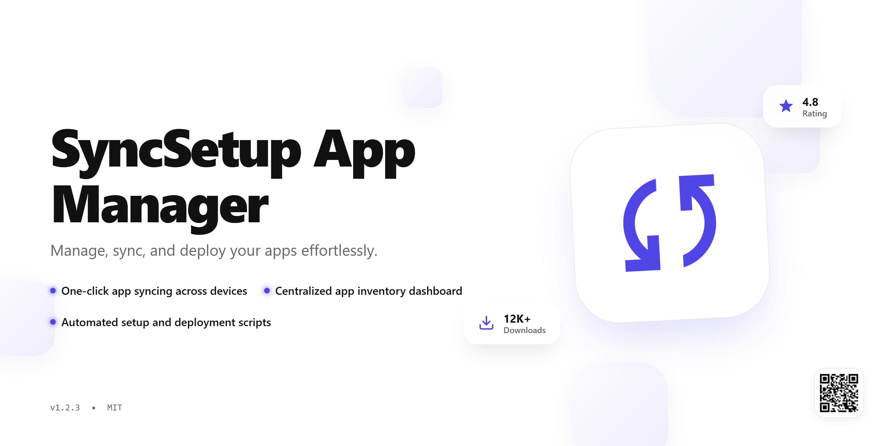

# SyncSetup App Manager: Automated Setup & App Deployment for Windows 11

### 🛠️ PowerShell Setup Button

    

---

SyncSetup App Manager is a Windows desktop application that centralizes software installation,, repair, and removal more than 300 curated applications alongside packages from winget, Scoop, Chocolatey, pip, and npm. It verifies every operation against the publisher's official source, validates digital signatures before execution, and reports precise results rather than assuming success. Built-in backup and transfer functions capture settings for dozens of browsers, applications, and games, letting you rebuild an entire system configuration on new hardware in minutes. An integrated optimization module manages startup entries, reclaims memory, and surfaces hardware details through a single native interface.

## 📋 System Requirements

- **OS:** Windows 10 / 11
- **Shell:** PowerShell 5.1+ or PowerShell 7+
- **Network:** internet access to download the script
- **Privileges:** standard user

## Features

### 📦 Application Catalogue

**314 curated applications** organized by category — browsers, games, communication, development, video, security, drivers, streaming, VPNs, and more.

- One-click installation from the **official publisher source**, or the **Microsoft Store** build when preferred
- Select a **specific version** or channel (stable, beta, nightly, LTS)
- **Enhancement modules** applied in one click: Spicetify for Spotify, Vencord, Equicord, BetterDiscord
- Web services without a native Windows client (YouTube, and similar) exposed as clearly labelled web shortcuts

### 🔄 Management

All installed applications **and** package-manager entries consolidated into a single list.

- everything in one action — **multiple concurrently** when safe (Windows Installer setups are never run in parallel)
- Live download throughput and explicit status reporting: ✅ complete · ℹ️ current · ⚠️ attention required · ❌ failed, with cause
- reminders at startup or on a 2, 4, or 8-hour interval
- **Scheduled maintenance**: automatic checking and updating on defined schedule
- Suppress a specific version, or exclude an application permanently

### 🖥️ Installed Application Inventory

- Full enumeration of software on the machine — including **portable applications** and titles installed by **Steam, Epic, Riot** and similar launchers
- **Other programs** tab: removal of any application Windows is aware of, via its official uninstaller
- Changes made outside the application are detected automatically
- When a file lock blocks an, the responsible process is identified and **Close and retry** is offered

### 💾 Backup & Transfer

**76 supported browsers, applications and games**: bookmarks, settings, extensions, Discord and its modules, Spotify, VS Code, Minecraft worlds, Steam collections, VALORANT settings, and more.

- locally or on another machine, **integrity-verified** via SHA-256
- Credentials, cookies, and sign-in sessions are **never** included
- **Export / import** the entire configuration as a single file
- **Profiles**: an application list reinstalled in one action on a new machine
- Optional backup to a private GitHub Gist

### ⚡ Performance Optimization

- **Optimize now**: terminates idle processes, memory, clears temporary files — with a health score derived from real measurements
- Recognizes hundreds of programs: which may be closed, which must remain running (drivers, antivirus, anti-tamper modules, synchronization services)
- **Startup manager**, including system-wide entries, with a confirmation prompt before disabling critical items
- Hardware and driver inventory at a glance

### 🎨 Interface & Personalization

- **16 themes** (dark, light, OLED, high contrast…), accent colors, density, and animation controls — or define own
- **Performance profile**: lighter rendering on modest hardware, richer on recent systems
- **English or French** localization
- Keyboard shortcuts, global search, notification center, and system tray integration
- **Self-updating** with verified downloads and one-click rollback to any prior version

## How It Works

SyncSetup operates as a unified orchestration layer over the package managers already present on system. Rather than maintaining its own distribution infrastructure, it queries the native APIs and command-line interfaces of winget, Scoop, Chocolatey, pip, npm, and additional supported managers to enumerate available packages, resolve versions, and execute operations.

**Package resolution and sourcing**

When you select an application, SyncSetup resolves the request against the configured package sources, prioritizing the publisher's official channel through winget or the Microsoft Store. Version pinning and channel selection (stable, beta, nightly, LTS) are handled at the resolver level, so the correct manifest is fetched before any binary touches disk. For publishers that distribute installers directly, SyncSetup retrieves the artifact and validates its digital signature prior to execution.

**Operation pipeline**

Each,, or uninstall follows a deterministic pipeline: pre-flight checks (disk space, conflicting processes, dependency availability), source retrieval, signature or hash verification, execution through the appropriate manager, and post-operation verification. The verification stage inspects the resulting system state—registry entries, installed package records, and file presence—to confirm the operation actually succeeded. Failures are surfaced with a human-readable diagnosis rather than a raw exit code.

**Concurrent scheduling**

SyncSetup serializes operations that would conflict—such as two Windows Installer transactions—while allowing independent to proceed in parallel. This scheduling logic prevents the file-lock contention and partial states that plague naive batch updaters.

**State tracking and drift detection**

The application maintains a local index of managed software and reconciles it against the live system on each launch. Changes made outside SyncSetup, including portable applications and game launchers, are detected and incorporated. When an is blocked by a file lock, the process holding the handle is identified and a guided retry is offered.

**Backup and transfer mechanics**

Backup operations collect application-specific configuration paths, validate the collected archive with SHA-256 checksums, and exclude credential material by design. Restoration verifies archive integrity before writing, and profile export serializes the full application manifest for replay on a separate machine.

**Local-first data model**

All configuration, indexes, and backup archives reside in the local application data directory. No account is required, and no telemetry is transmitted. Optional online synchronization is opt-in and scoped to the user's chosen endpoint. Self are delivered as signed artifacts validated with SHA-512 and support rollback to any retained prior version.

## Compatibility

SyncSetup App Manager is built for Windows desktop environments and integrates directly with the package managers already present on system. The application targets Windows 10 (version 1809 and later) and Windows 11, and runs natively on both x64 and ARM64 architectures. It requires the.NET desktop runtime, which the installer provisions automatically when it is absent.

Package manager integration is handled through their respective command-line interfaces. SyncSetup detects winget, Scoop, Chocolatey, pip, npm, and the additional supported managers at startup and exposes each one through a unified catalogue. When a manager is missing, the corresponding entries are simply marked unavailable rather than failing the operation. Version pinning, channel selection (stable, beta, nightly, LTS), and portable application discovery are supported wherever the underlying manager exposes that metadata.

Backup and cover 76 browsers, applications, and games, with integrity verification performed via SHA-256 on every archive. Profiles and full exports are portable machines running the same major Windows version, so a configuration captured on one PC can be reinstated on another without manual reinstallation. Scheduled maintenance, startup entries, and theme settings persist in the local application data directory and survive in-place upgrades.

Administrator rights are optional. Standard user sessions are sufficient for the majority of operations, and Windows elevates individual installers through its own consent prompt when required. An optional elevated mode reduces repeated prompts for bulk operations while still honoring system-level protections for drivers and critical startup items. Self are validated with SHA-512 before installation, and any previous version can be restored through the built-in rollback mechanism.

## Safety and Verification

SyncSetup treats safety as an architectural requirement, not an afterthought. Every operation that touches the system is validated before, during, and after execution.

**Publisher-sourced distribution.** Packages are resolved through winget or the Microsoft Store and pulled from the publisher's own delivery channel. When SyncSetup must retrieve a publisher's standalone installer directly, the binary's digital signature is validated against the trusted certificate chain prior to execution. Unsigned or mismatched payloads are rejected outright.

**Post-operation verification.** An,, or removal is never marked complete on exit code alone. SyncSetup re-queries the system state after each operation and confirms the expected version, registration, and file presence. Discrepancies surface as actionable diagnostics rather than silent failures.

**Optional elevation, never bypassed.** SyncSetup runs with standard user rights by default. When an installer requires elevation, the Windows UAC consent prompt is presented unchanged — SyncSetup does not attempt to circumvent or suppress it. Protected system components and critical startup entries require explicit confirmation before any modification.

**Local-first data handling.** Configuration, profiles, and backups reside under `%APPDATA%\syncsetup` on the local machine. Backups are integrity-checked with SHA-256 on. Credentials, session tokens, cookies, and payment data are excluded from backup payloads by design. Optional online synchronization is opt-in and disabled by default; no telemetry is collected and no account is required.

**Verified self with rollback.** Application are validated (SHA-512) before installation, and any prior version can be restored through a one-click rollback path, keeping the channel auditable and reversible.

## FAQ

**Is SyncSetup available at no cost?**

Yes — SyncSetup is fully accessible at no cost. There is no premium tier, no advertising, and no account requirement. Every feature described in this document is included in the standard distribution.

**How does SyncSetup differ from winget, UniGetUI or Ninite?**

SyncSetup operates on top of winget, similarly to UniGetUI, and covers the full Ninite catalogue. Beyond package installation, it verifies every operation's result, surfaces errors in plain language, and application settings, migrates configuration to a new machine, and provides system optimization and startup management — all within a single interface.

**Is administrator elevation required?**

No. SyncSetup runs with standard user rights; Windows prompts for elevation only when an individual installer requires it. An optional administrator mode (one Windows confirmation, once per session) reduces repeated prompts. Applications that refuse administrator rights are automatically launched with normal rights.

**Where does SyncSetup store data and backups?**

Configuration and backups reside in `%APPDATA%\syncsetup` on local machine, with backups in `%APPDATA%\syncsetup\Sauvegardes` or any folder you designate — a cloud-synced folder works well for cross-machine access.

**What network endpoints does SyncSetup contact?**

winget and the package registries you actively use (for installation and), GitHub (for SyncSetup's own self), and icon services (for application icons). Online backup endpoints — a GitHub Gist or a SyncSetup account — are contacted only when you explicitly enable them. No other connections are made.

**How is SyncSetup uninstalled?**

Through Windows Settings › Apps › SyncSetup › Uninstall. settings remain in `%APPDATA%\syncsetup` until that folder is manually removed.

## License

SyncSetup App Manager is distributed under a permissive, source-available license that grants individuals and organizations the right to use, copy, modify, and redistribute the software, provided that the copyright notice and this license text remain intact in all copies or substantial portions of the software.

The license permits integration into commercial and non-commercial workflows, internal tooling, and automated deployment pipelines without additional authorization. Redistribution of modified builds is allowed; however, modified versions must be clearly identified as such and must not imply endorsement by the original authors. Attribution in documentation or about screens is appreciated but not mandatory beyond the retained copyright notice.

The software is provided "as is", without warranty of any kind, express or implied, including but not limited to the warranties of merchantability, fitness for a particular purpose, and non-infringement. In no event shall the authors or copyright holders be liable for any claim, damages, or other liability, whether in an action of contract, tort, or otherwise, arising from, out of, or in connection with the software or the use or other dealings in the software.

The full, canonical license text accompanying each release governs usage; where this summary and the canonical text diverge, the canonical text prevails. Licensing inquiries regarding redistribution at scale or embedded distribution may be directed to the maintainers through the project's issue tracker.